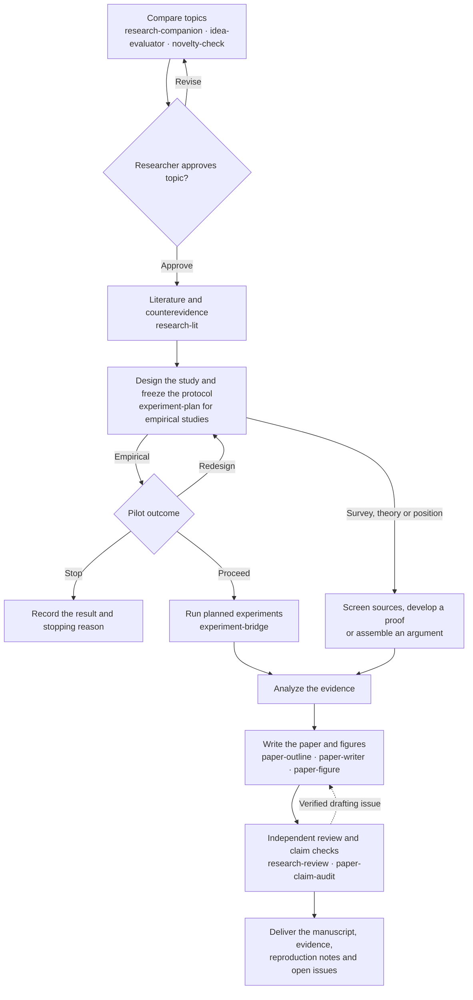

#  Auto-Research System

[简体中文](README_CN.md) · [Skill catalog](.claude/skills/) · [Changelog](CHANGELOG.md) · [License](LICENSE)

<p align="center"></p>

A set of 17 core research skills for Claude Code, Codex and Antigravity, built primarily for computer science. Bring a question, an experiment directory or a draft. You can ask for one literature search or figure revision, or take a project from topic selection through independent review and a reproducible handoff.

**New in v1.5.** The `research-gate` skill can resume a project from saved files, show which inputs changed and tie approval to the exact proposal or protocol a researcher saw. The claim audit now also traces pivotal empirical method descriptions to the implementation used for the reported run. [Gate controller](.claude/skills/research-gate/SKILL.md) · [Claim audit](.claude/skills/paper-claim-audit/SKILL.md)

## Get started

You’ll need Python 3.10+ and a host CLI you’ve signed in to. From the repository root, run the setup command once for your host. After setup, use the start command for each session.

| Host | First-time setup | Start |
|---|---|---|
| Claude Code | `bash install.sh --host claude` | `claude` |
| Codex | `bash install.sh --host codex` | `codex` |
| Antigravity | `bash install.sh --host antigravity` | `agy` |

The session identifies its host. Codex and Antigravity share the same generated skill files, so both can use one checkout. A requested review uses a fresh host subagent by default. Select Codex for optional external review. If it is unavailable, the host records the fallback and uses a fresh local subagent. The manuscript reviewer reads the paper and figures; the materials auditor checks the underlying code, data and run records. [Reviewer selection](.claude/skills/shared-references/reviewer-routing.md)

Each host drafts and polishes directly. Antigravity is the optional external writer for either task. Use an existing Antigravity MCP connection or set `ANTIGRAVITY_MCP_SERVER` to an installed Python adapter’s absolute path when configuring this repository for Claude Code or Codex. Existing server entries are preserved. Antigravity handles writing natively when it is the host. [Writing rules](.claude/skills/shared-references/writing-host.md)

A first task you can try in Claude Code is `/research-lit Find the closest published work to the question in my draft and show where our assumptions differ.` In Codex, use `$research-lit`; in Antigravity, invoke `research-lit` (or `/research-lit` / `$research-lit`) with the same request.

## Choose how to work

The routing, delegation and approval rules below apply to this project. Each host reads its own project guide. [Claude Code](CLAUDE.md) · [Codex](AGENTS.md) · [Antigravity](GEMINI.md)

| If you want to… | Claude Code / Codex / Antigravity | What happens |
|---|---|---|
| Work on the file in front of you | e.g. `/paper-polish` / `$paper-polish` / `paper-polish` | The skill edits the requested material and runs the relevant checks. This is the default scope. |
| Coordinate a study through an agreed endpoint | `/research-auto` / `$research-auto` / `research-auto` | The host selects skills, verifies each handoff and pauses for topic approval. Pilot stopping rules and resource limits still apply. |
| Delegate research decisions after choosing a topic | `/research-autopilot` / `$research-autopilot` / `research-autopilot` | After you approve the topic, the host records design decisions and asks for any additional access, compute or budget it needs. |
| Resume from files and verify each stage | `/research-gate` / `$research-gate` / `research-gate` | A Python controller records artifacts, approvals and evidence on disk. The host does the research and assesses its scientific merits. |

For a contested claim or a choice between topics, the optional `debate-hub` plugin collects independent assessments against the same source files and can prepare a decision card for human review. Register it separately for Claude Code, Codex or Antigravity. [Plugin setup and examples](.agents/mcp-servers/debate-hub/README.md)

## Research workflow

The diagram follows a project from a new topic. For an existing study, start with the work you already have. The empirical branch shows the pilot decision. A survey, theory or position paper follows the evidence requirements in its own protocol. [Stage and skill map](.claude/skills/research-agent-team/references/full-flow.md)



In gated mode, topic approval is mandatory and protocol approval is on by default. A researcher can disable the latter at initialization with `--no-plan-approval`. A confirmed issue can reopen the affected stage, including design or analysis. A reviewer's request for another experiment can remain an open suggestion. Submission and public release require your authorization. [Gate contracts](.claude/skills/research-gate/references/gates.md)

## Working with a gated project

Invoke the gate skill in your host, or inspect the controller directly. From the clone, set `PROJECT` to the directory for your study.

```bash
PROJECT=../my-study
GATE="$PWD/.claude/skills/research-gate/scripts/research_gate.py"
python3 "$GATE" init --root "$PROJECT" --goal "Compare two retrieval methods on my existing evaluation set"
python3 "$GATE" preflight --root "$PROJECT"
python3 "$GATE" continue --root "$PROJECT"
```

- **Resume.** Run `continue` again to find the first stage that needs work or approval. Stage documents live under `research/`, and saved state lives under `.research-gate/`.
- **Trace a claim.** Evidence records point to a registered snapshot or local result file. The gate matches quoted anchors against the file. The host checks whether the passage supports the claim.
- **Inspect a finding.** The run-record, LaTeX and figure checks are enabled by default and can be changed per project. A suspected duplicate table or figure style issue is reported for inspection. Missing evidence references and changed audited inputs require a correction or a fresh check. [Checks and settings](.claude/skills/research-gate/SKILL.md)
- **Choose a language.** Reports default to Chinese. Specify a language in your request, or set `--report-language` when initializing a gated project.

## Find a skill

| Task | Start here |
|---|---|
| Compare research directions and find the closest work | [Ideation](.claude/skills/research-companion/SKILL.md) · [Topic evaluation](.claude/skills/idea-evaluator/SKILL.md) · [Novelty check](.claude/skills/novelty-check/SKILL.md) · [Literature & benchmarks](.claude/skills/research-lit/SKILL.md) |
| Design a study, run experiments and interpret results | [Experiment plan](.claude/skills/experiment-plan/SKILL.md) · [Implementation & execution](.claude/skills/experiment-bridge/SKILL.md) · [Analysis](.claude/skills/analyze-results/SKILL.md) |
| Outline, draft, polish, draw figures or check citations | [Outline & story](.claude/skills/paper-outline/SKILL.md) · [Writing](.claude/skills/paper-writer/SKILL.md) · [Polish](.claude/skills/paper-polish/SKILL.md) · [Figures](.claude/skills/paper-figure/SKILL.md) · [Citations & venues](.claude/skills/citation-and-venue/SKILL.md) |
| Check claims against results or prepare a response | [Claim audit](.claude/skills/paper-claim-audit/SKILL.md) · [Independent review](.claude/skills/research-review/SKILL.md) · [Rebuttal & response](.claude/skills/rebuttal-response/SKILL.md) |

## Acknowledgements and license

Thank you to the open-source research community and maintainers whose tools and standards support this ecosystem. This project is distributed under CC BY-NC-SA 4.0; third-party components retain their original licenses and attribution in [`THIRD_PARTY_NOTICES.md`](THIRD_PARTY_NOTICES.md). [License](LICENSE) · [Third-party notices](THIRD_PARTY_NOTICES.md)

Feedback and contributions are welcome, especially concrete examples where a skill draws a wrong conclusion or asks for unnecessary work. [Issues](https://github.com/AfonsoZhang/auto-research-system/issues) · [Pull requests](https://github.com/AfonsoZhang/auto-research-system/pulls)
