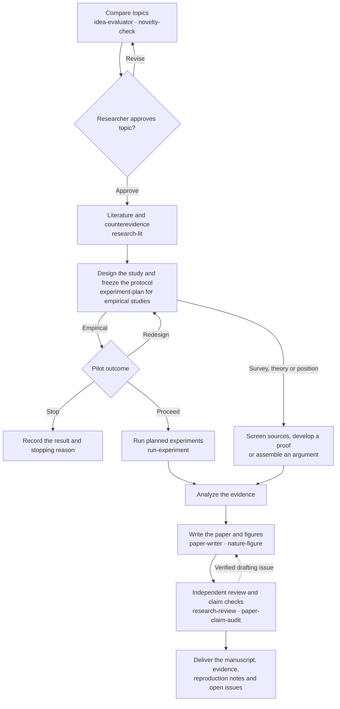

# Auto-Research System

[简体中文](README_CN.md) · [Skill catalog](.claude/skills/) · [License](LICENSE)

<p align="center"></p>

A set of 38 research skills for Claude Code and Codex, built primarily for computer science. Bring a question, an experiment directory or a draft. You can ask for one literature search or figure revision, or take a project from topic selection through independent review and a reproducible handoff.

**New in v1.5.** The `research-gate` skill can resume a project from saved files, show which inputs changed and tie approval to the exact proposal or protocol a researcher saw. The claim audit now also traces pivotal empirical method descriptions to the implementation used for the reported run. [Gate controller](.claude/skills/research-gate/SKILL.md) · [Claim audit](.claude/skills/paper-claim-audit/SKILL.md)

## Get started

Use Python 3.10+ and a configured host CLI. Our usual setup is Claude Code for research and writing, with Codex as the independent reviewer. For the reverse setup, run the Codex installer and open this directory as a trusted project. Each installer writes its configuration locally. [Installer](install.sh) · [Reviewer setup](.agents/mcp-servers/codex-exec/README.md)

```bash
git clone https://github.com/AfonsoZhang/auto-research-system.git
cd auto-research-system
bash install.sh --host claude
claude
```

For Codex, run `bash install.sh --host codex` in the clone and start `codex`. The installer builds the Codex skills from the same sources and configures the Claude reviewer bridge. [Codex host contract](config/codex/host.md)

A first task you can try in Claude Code is `/research-lit Find the closest published work to the question in my draft and show where our assumptions differ.` In Codex, use `$research-lit` with the same request.

## Choose how to work

| If you want to… | Claude Code / Codex | What happens |
|---|---|---|
| Work on the file in front of you | e.g. `/paper-polish` / `$paper-polish` | The skill edits the requested material and runs the relevant checks. This is the default scope. |
| Coordinate a study through an agreed endpoint | `/research-auto` / `$research-auto` | The host selects skills, verifies each handoff and pauses for topic approval. Pilot stopping rules and resource limits still apply. |
| Delegate research decisions after choosing a topic | `/research-autopilot` / `$research-autopilot` | After you approve the topic, the host records design decisions and asks for any additional access, compute or budget it needs. |
| Resume from files and verify each stage | `/research-gate` / `$research-gate` | A Python controller records artifacts, approvals and evidence on disk. The host does the research and assesses its scientific merits. |

For a contested claim or a choice between topics, the optional `debate-hub` plugin collects independent assessments against the same source files and can prepare a decision card for human review. Register it separately for Claude Code or Codex. [Plugin setup and examples](.agents/mcp-servers/debate-hub/README.md)

## Research workflow

The diagram follows a project from a new topic. For an existing study, start with the work you already have. The empirical branch shows the pilot decision. A survey, theory or position paper follows the evidence requirements in its own protocol. [Stage and skill map](.claude/skills/research-agent-team/references/full-flow.md)



In gated mode, topic approval is mandatory and protocol approval is on by default. A researcher can disable the latter at initialization with `--no-plan-approval`. A confirmed issue can reopen the affected stage, including design or analysis. A reviewer's request for another experiment can remain an open suggestion. Submission and public release require your authorization. [Gate contracts](.claude/skills/research-gate/references/gates.md)

## Working with a gated project

Invoke the gate skill in your host, or inspect the controller directly. From the clone, set `PROJECT` to the directory for your study.

```bash
PROJECT=../my-study
GATE="$PWD/.claude/skills/research-gate/scripts/research_gate.py"
python3 "$GATE" init --root "$PROJECT" --goal "Compare two retrieval methods on my existing evaluation set"
python3 "$GATE" preflight --root "$PROJECT"
python3 "$GATE" continue --root "$PROJECT"
```

- **Resume.** Run `continue` again to find the first stage that needs work or approval. Stage documents live under `research/`, and saved state lives under `.research-gate/`.
- **Trace a claim.** Evidence records point to a registered snapshot or local result file. The gate matches quoted anchors against the file. The host checks whether the passage supports the claim.
- **Inspect a finding.** The run-record, LaTeX and figure checks are enabled by default and can be changed per project. A suspected duplicate table or figure style issue is reported for inspection. Missing evidence references and changed audited inputs require a correction or a fresh check. [Checks and settings](.claude/skills/research-gate/SKILL.md)
- **Choose a language.** Reports default to Chinese. Specify a language in your request, or set `--report-language` when initializing a gated project.

## Find a skill

| Task | Start here |
|---|---|
| Compare research directions and find the closest work | [Topic evaluation](.claude/skills/idea-evaluator/SKILL.md) · [Novelty check](.claude/skills/novelty-check/SKILL.md) · [Literature search](.claude/skills/research-lit/SKILL.md) |
| Design a study, run a pilot and interpret results | [Benchmarks](.claude/skills/benchmark-research-skill/SKILL.md) · [Experiment plan](.claude/skills/experiment-plan/SKILL.md) · [Execution](.claude/skills/run-experiment/SKILL.md) · [Analysis](.claude/skills/analyze-results/SKILL.md) |
| Draft a paper, revise figures or check citations | [Writing](.claude/skills/paper-writer/SKILL.md) · [Figures](.claude/skills/nature-figure/SKILL.md) · [Reference verification](.claude/skills/nature-ref-verifier/SKILL.md) |
| Check claims against results or prepare a response | [Claim audit](.claude/skills/paper-claim-audit/SKILL.md) · [Independent review](.claude/skills/research-review/SKILL.md) · [Reviewer response](.claude/skills/nature-response/SKILL.md) |

## Acknowledgements and license

Thank you to the researchers and maintainers whose tools, examples and methods this project builds on. The project is distributed under CC BY-NC-SA 4.0. Bundled components retain their own licenses. [License](LICENSE) · [Third-party notices](THIRD_PARTY_NOTICES.md)

<details>
<summary>Sources and contributions</summary>

| Source | Used for |
|---|---|
| [wanshuiyin/Auto-claude-code-research-in-sleep](https://github.com/wanshuiyin/Auto-claude-code-research-in-sleep) (ARIS) | research-review, paper-claim-audit, research-lit, novelty-check, experiment-plan, experiment-bridge, run-experiment, analyze-results, literature tools, codex-exec bridge |
| [HKUSTDial/Supervisor-Skills](https://github.com/HKUSTDial/Supervisor-Skills) | paper-writer, paper-polish, intro-drafter, deep-research, idea-evaluator, pre-submission-reviewer, figure-designer, rebuttal-guidance and other writing skills |
| [Yuan1z0825/nature-skills](https://github.com/Yuan1z0825/nature-skills) | nature-figure, nature-reader, nature-ref-verifier, nature-response |
| [Chen Liu, figures4papers](https://github.com/ChenLiu-1996/figures4papers) | Plotting scripts and figure previews retained as references in `nature-figure`. See the [local index](.claude/skills/nature-figure/references/demos.md) and [asset notice](.claude/skills/nature-figure/assets/figures4papers/THIRD_PARTY_NOTICES.md). |
| [ScientistTwo, Google Cloud AI Research](https://scientist-two.github.io/#integrity) | Its method–code alignment audit inspired the check that traces pivotal empirical method claims to the implementation used for the reported run. |
| [Sacred Heart University Library, *Organizing Academic Research Papers*](https://library.sacredheart.edu/organizing-research-papers/intro) | Its topic and outline guidance informed how we explain changes to a research question and check the support for each planned section. The guide credits Robert V. Labaree of USC Libraries for the original materials. |
| [andrehuang/research-companion](https://github.com/andrehuang/research-companion) | research-companion and the brainstormer, idea-critic, research-strategist agents |
| [Orchestra-Research/AI-Research-SKILLs](https://github.com/Orchestra-Research/AI-Research-SKILLs) | brainstorming-research-ideas, creative-thinking-for-research |
| [Spark-To-Paper-Skills/spark-to-paper-skills](https://github.com/Spark-To-Paper-Skills/spark-to-paper-skills) | ts-paper-plan, ts-paper-cite and paper templates |
| [wanshuiyin/Anti-Autoresearch](https://github.com/wanshuiyin/Anti-Autoresearch) | the four integrity pre-check scripts and the defect taxonomy behind the integrity map; README layout |
| [wanshuiyin/HERO-Anti-OverDefense](https://github.com/wanshuiyin/HERO-Anti-OverDefense) | README layout |
| [ShaishavMaisuria/research-paper-lifecycle-skills](https://github.com/ShaishavMaisuria/research-paper-lifecycle-skills) | select-venue |
| [Rimagination/good-story](https://github.com/Rimagination/good-story) | good-story |
| [EternalWavee/benchmark-research-skill](https://github.com/EternalWavee/benchmark-research-skill) | benchmark-research-skill |
| [UKGovernmentBEIS/inspect_evals](https://github.com/UKGovernmentBEIS/inspect_evals) | benchmark validity checklist |
| [aipoch/medical-research-skills](https://github.com/aipoch/medical-research-skills) | limitation-and-risk-writer |
| [Airjiannan05/research-paper-workflow-skill](https://github.com/Airjiannan05/research-paper-workflow-skill) | experiment-record conventions |
| [panbibliotekar/gaidet-declaration](https://github.com/panbibliotekar/gaidet-declaration) | AI-use disclosure terms (ai-use-drafter) |
| [blader/humanizer](https://github.com/blader/humanizer) | prose checks in paper-polish and paper-writer |
| [AIScientists-Dev/academic-humanizer](https://github.com/AIScientists-Dev/academic-humanizer) | prose checks in paper-polish and paper-writer |
| [acl-org/acl-style-files](https://github.com/acl-org/acl-style-files) | ACL LaTeX style files |
| [anthropics/knowledge-work-plugins](https://github.com/anthropics/knowledge-work-plugins) | ideas for problem selection (no text copied) |
| [joshzyj/open-scholar-skill](https://github.com/joshzyj/open-scholar-skill) | the idea of an exemplar knowledge base (no text copied) |
| [microsoft/ResearchStudio](https://github.com/microsoft/ResearchStudio) (ResearchStudio-Idea, arXiv:2607.04439) | ideas for empirical ideation patterns, contrastive failure modes, four-axis collision checks, evidence readiness and Idea Cards (no text copied) |

The problem-selection notes also draw on Fischbach, *Cell* 2024 ([doi:10.1016/j.cell.2024.03.012](https://doi.org/10.1016/j.cell.2024.03.012)). Every component keeps its original notice; revisions and licenses are listed in [`THIRD_PARTY_NOTICES.md`](THIRD_PARTY_NOTICES.md). If I have missed or misattributed anything, please tell me and I will fix it right away.

</details>

This is my first research system. Corrections are welcome, especially examples where a skill draws the wrong conclusion or asks for unnecessary work. [Issues](https://github.com/AfonsoZhang/auto-research-system/issues) · [Pull requests](https://github.com/AfonsoZhang/auto-research-system/pulls)
