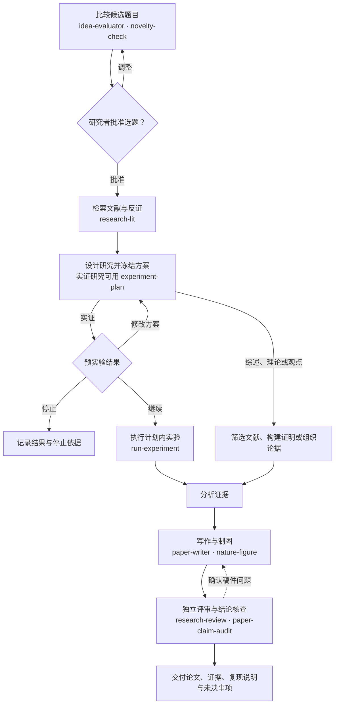

#  Auto-Research System 自动科研系统

[English](README.md) · [技能目录](.claude/skills/) · [许可证](LICENSE)

<p align="center"></p>

**击碎科研壁垒，吾辈义不容辞。** 这套工具包含 38 个面向 Claude Code、Codex 和 Antigravity 的研究技能，主要服务于计算机科学研究。你可以带来一个问题、一组实验结果或一篇草稿，只做一次文献检索、改一张图，也可以从选题一直做到独立审查和复现材料交付。

**v1.5 新增了什么？** `research-gate` 可以从项目文件恢复研究进度，指出哪些输入发生了变化，并把批准记录绑定到研究者实际看过的题目或方案版本。论文核查也从数字延伸到方法：影响实证结论的方法描述，可以追溯到产生该结果的运行和代码。[阶段控制器](.claude/skills/research-gate/SKILL.md) · [论文结论核查](.claude/skills/paper-claim-audit/SKILL.md)

## 快速开始

准备好 Python 3.10+，并登录所用宿主的 CLI。首次使用时，在仓库根目录运行该宿主对应的配置命令。配置完成后，每次使用时直接运行启动命令即可。

| 宿主 | 首次配置 | 启动 |
|---|---|---|
| Claude Code | `bash install.sh --host claude` | `claude` |
| Codex | `bash install.sh --host codex` | `codex` |
| Antigravity | `bash install.sh --host antigravity` | `agy` |

当前会话决定宿主。Codex 和 Antigravity 共用一份生成的技能文件，可以在同一份仓库里交替使用。请求审查时，默认由当前宿主新建子代理。可指定 Codex 做外部审查；Codex 不可用时记录原因，改用本地子代理。论文审稿人读正文和图表，材料审查者核对代码、数据和运行记录。[审查规则](.claude/skills/shared-references/reviewer-routing.md)

三个宿主都可以直接起草、润色。两项任务的可选外援均为 Antigravity。可使用已有的 Antigravity MCP 连接，或在为 Claude Code 或 Codex 配置本仓库时，用 `ANTIGRAVITY_MCP_SERVER` 指定已安装的 Python 适配器绝对路径。配置脚本保留已有的同名配置。在 Antigravity 中启动时由它直接执行。[写作规则](.claude/skills/shared-references/writing-host.md)

可以从一个具体任务开始。在 Claude Code 输入 `/research-lit 找出与我这份草稿最接近的已发表工作，说明我们的研究假设有什么差别。` 在 Codex 中用 `$research-lit`，在 Antigravity 中直接提 `research-lit`（或 `/research-lit` / `$research-lit`）即可。

## 选哪个入口

下列入口、任务委派与审批规则只适用于本项目。各宿主读取各自的项目说明。[Claude Code](CLAUDE.md) · [Codex](AGENTS.md) · [Antigravity](GEMINI.md)

| 你想做什么 | Claude Code / Codex / Antigravity | 它会做什么 |
|---|---|---|
| 修改手上的文件 | 例如 `/paper-polish` / `$paper-polish` / `paper-polish` | 处理指定材料，完成相应核查后交付。这是默认工作方式。 |
| 把一项研究推进到约定终点 | `/research-auto` / `$research-auto` / `research-auto` | 主代理选择技能，核验各阶段产物。选题需要你批准，试验停止条件和资源上限继续生效。 |
| 选题后委托研究决策 | `/research-autopilot` / `$research-autopilot` / `research-autopilot` | 你批准题目后，主代理决定并记录设计取舍。需要额外权限、算力或预算时向你申请。 |
| 跨会话继续，并逐阶段核验 | `/research-gate` / `$research-gate` / `research-gate` | Python 控制器保存产物、审批和证据。宿主代理执行研究，并判断证据能支持什么结论。 |

遇到有争议的结论，或需要比较几个候选题目时，可选插件 `debate-hub` 能让多个评审分别查阅同一组原始材料，并生成供研究者裁决的卡片。插件需在 Claude Code、Codex 或 Antigravity 中单独注册。[插件配置与用法](.agents/mcp-servers/debate-hub/README.md)

## 研究工作流

下图从新选题画起。已有研究可以接着现有材料做。实证研究要根据预实验决定继续、改方案还是停止；综述、理论和观点论文则按各自方案组织证据。[完整阶段与技能对照](.claude/skills/research-agent-team/references/full-flow.md)



在 `research-gate` 中，选题必须由你批准，研究方案默认也需批准。初始化时可用 `--no-plan-approval` 关闭方案审批。核实的问题可以退回受影响的阶段，包括设计或分析；评审提出的额外实验可以保留为建议。投稿和公开发布需要另行授权。[阶段检查规则](.claude/skills/research-gate/references/gates.md)

## 使用阶段控制器

在宿主里调用 `research-gate` 即可。也可以直接检查控制器。从仓库根目录运行以下命令，把 `PROJECT` 改为你的研究目录。

```bash
PROJECT=../my-study
GATE="$PWD/.claude/skills/research-gate/scripts/research_gate.py"
python3 "$GATE" init --root "$PROJECT" --goal "在现有评测集上比较两种检索方法"
python3 "$GATE" preflight --root "$PROJECT"
python3 "$GATE" continue --root "$PROJECT"
```

- **换会话后继续。** 再次运行 `continue`，即可找到第一个需要处理或批准的阶段。各阶段文档保存在 `research/`，控制器状态保存在 `.research-gate/`。
- **追溯结论。** 证据记录指向已登记的来源快照或本地结果文件。程序检查引文能否在文件中找到，宿主代理再判断这段材料能否支持论文的说法。
- **处理脚本提示。** 运行记录、LaTeX 和图表检查默认开启，可按项目调整。疑似重复表格和图表样式问题交给代理复核。证据引用失效、已审计的输入发生变化，则需要修正或重新核验。[检查项与设置](.claude/skills/research-gate/SKILL.md)
- **选择报告语言。** 默认使用中文。可以在请求中指定其他语言，也可以在初始化时设置 `--report-language`。

## 按任务找技能

| 任务 | 技能入口 |
|---|---|
| 比较方向，找最接近的工作 | [选题评估](.claude/skills/idea-evaluator/SKILL.md) · [新颖性核查](.claude/skills/novelty-check/SKILL.md) · [文献检索](.claude/skills/research-lit/SKILL.md) |
| 设计研究、跑预实验、解读结果 | [基准选择](.claude/skills/benchmark-research-skill/SKILL.md) · [实验设计](.claude/skills/experiment-plan/SKILL.md) · [运行实验](.claude/skills/run-experiment/SKILL.md) · [结果分析](.claude/skills/analyze-results/SKILL.md) |
| 写论文、改图、核对引用 | [论文写作](.claude/skills/paper-writer/SKILL.md) · [论文图表](.claude/skills/nature-figure/SKILL.md) · [参考文献核验](.claude/skills/nature-ref-verifier/SKILL.md) |
| 核实论文结论或回复审稿意见 | [结论核查](.claude/skills/paper-claim-audit/SKILL.md) · [独立评审](.claude/skills/research-review/SKILL.md) · [审稿回复](.claude/skills/nature-response/SKILL.md) |

## 致谢与许可

感谢开源科研社区及各位维护者为这一生态提供的工具与规范。本项目采用 CC BY-NC-SA 4.0，各第三方组件保留其原有许可证与署名声明，详见 [`THIRD_PARTY_NOTICES.md`](THIRD_PARTY_NOTICES.md)。[项目许可证](LICENSE) · [第三方来源与许可](THIRD_PARTY_NOTICES.md)

欢迎反馈与共建。如果遇到技能误判、要求多做无必要的实验，或说明写得不清楚，欢迎带着具体例子提交反馈。[提 Issue](https://github.com/AfonsoZhang/auto-research-system/issues) · [提交 PR](https://github.com/AfonsoZhang/auto-research-system/pulls)
